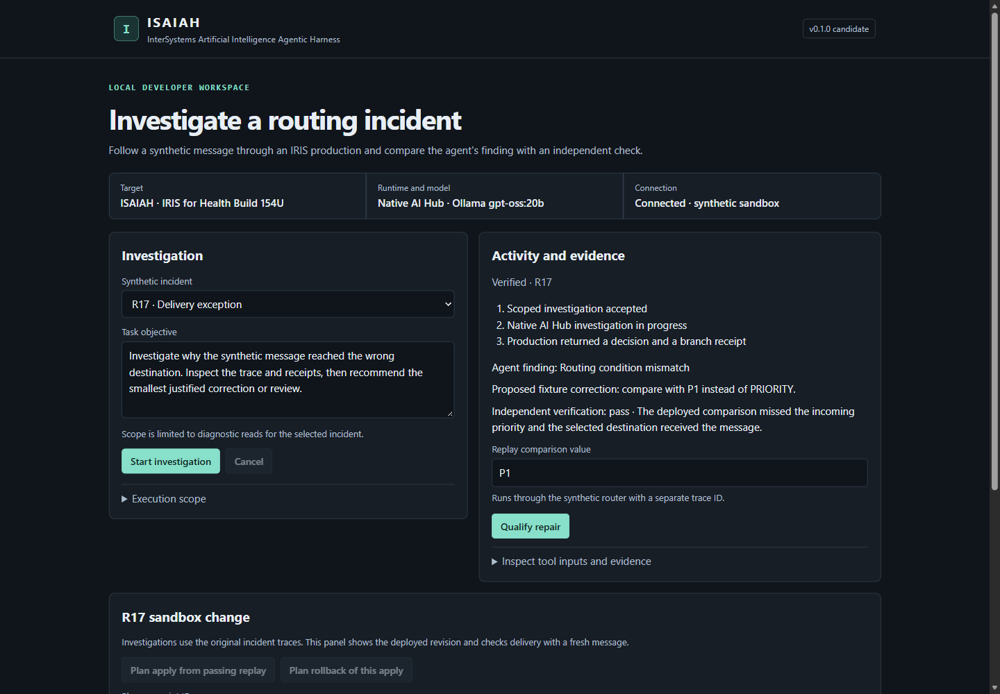

# ISAIAH 0.2.0

<p align="center">
  <a href="#start"><strong>Docker Quick Start</strong></a> &nbsp;·&nbsp;
  <a href="#ipm"><strong>IRIS / IPM Install</strong></a> &nbsp;·&nbsp;
  <a href="#demonstrate-the-native-workflow"><strong>Native Workflow</strong></a> &nbsp;·&nbsp;
  <a href="#public-experiences"><strong>Demo &amp; Media</strong></a> &nbsp;·&nbsp;
  <a href="#inspect-the-implementation"><strong>Source &amp; Evidence</strong></a>
</p>

<p align="center"></p>

<p align="center"><strong>Investigate with context. Verify with evidence.</strong><br>Native AI Hub investigations · Scoped evidence · Independent verification · Explicit approval</p>

**ISAIAH (InterSystems Artificial Intelligence Agentic Harness)** is an open-source agentic development and learning harness for InterSystems. Its synthetic Health workflow investigates routing incidents inside an IRIS Interoperability production. A native AI Hub agent selects a Diagnostic or Review branch, and a deterministic verifier checks the decision against separate IRIS and destination records. The supported repair and rollback each require explicit approval.

**Developer / Teacher / Engineer** describes the direction. The developer preview supports scoped source inspection, reviewed patches and one constrained HL7-to-FHIR example. Teaching connects retained observations to InterSystems concepts through the CLI and service. Main browser teaching remains gated. [Developer workflow](docs/developer-workflow.md) · [Contest task](https://openexchange.intersystems.com/contest/49)

**Try it:** [Open the browser simulation](https://kennethjsmithdev.github.io/ISAIAH/) to explore R17 and R29 without installing anything. The simulation uses authored examples. For a native run, follow [requirements](#supported-environment) → [acquire dependencies](#acquire-the-dependencies) → [start](#start) → open **http://127.0.0.1:18757/** and [run R17, then R29](#demonstrate-the-native-workflow). [Inspect the source](#inspect-the-implementation) or [run the offline checks](#offline-checks).

**Provisional demonstration edit — genuine recorded synthetic workflow. Manually recorded presentation footage is planned.**

Download the captioned 30-second R17/R29 recording (3.2 MiB). [WebM](docs/media/isaiah-judge-demo.webm) · [Recording notes](#recorded-demonstration)

## What is new in 0.2.0

- **Inspect contracts before building.** Export OpenAPI 3.1 for the read and search operations advertised in approved FHIR R4, R4B, or R5 CapabilityStatements. Compare a component's declared message types with those recorded in an approved trace.
- **Review a synthetic HL7-to-FHIR mapping before deployment.** Ask native AI Hub to propose test inputs. ISAIAH derives the expected results from the fixed fixture contract. Export a reviewable Organization application and test from a versioned interface spec.
- **Understand the evidence in the CLI.** Coach, Focus, and Companion present the same retained facts and explain the difference between an advertised operation and an observed response.

[Developer workflow and CLI examples](docs/developer-workflow.md#propose-a-synthetic-mapping-test)

### Community Idea: FHIR to OpenAPI

ISAIAH implements the read and search export slice of [DPI-I-804](https://ideas.intersystems.com/ideas/DPI-I-804) with its own converter. Supply an approved local FHIR R4, R4B, or R5 CapabilityStatement to generate OpenAPI 3.1 JSON. Try the [three-release walkthrough](docs/fhir-openapi.md) to export the documents and see which operations ISAIAH leaves out.

## Why ISAIAH Is Different

- **The agent participates in the production.** Native AI Hub calls the scoped evidence tool, returns a structured decision and drives an actual Interoperability branch.
- **Its answer must survive a separate check.** The verifier recomputes the expected finding, proposal and branch from independent production and destination readback. A model completion alone earns no passing result.
- **A proposed repair has several gates.** The synthetic R17 route supports replay, a sealed plan, explicit local approval, delivery verification and separately approved rollback. Recovery reads durable evidence when a response is lost.
- **Repeated evidence does not pretend to be new learning.** The standalone trace ledger requires explicit acceptance, checks compatibility scope and can restore the preceding revision. Identical accepted procedure content reports unchanged while retaining the new run.

The browser provides investigations, activity, evidence, replay and approval controls. Its section navigation leads to Investigation, Activity and evidence, Approval boundary and Learning review; the visible run identity and recorded branch keep results associated with their source. The CLI shares its service and adds approved-session tracing, reviewed learning and short documentation-backed explanations. The learning procedure and write capability each have a deliberately narrow scope; see [limits](#limits).

## Inspect the implementation

The links below identify the implementation in this source tree. The R29 human-worklist boundary is owned by [the Workflow process](iris/cls/Isaiah/HumanReview.cls), [review gate](iris/cls/Isaiah/ReviewGate.cls), and [custom outbound adapter](iris/cls/Isaiah/ReviewFileAdapter.cls).


| Question | Owning source |
|---|---|
| Where does native AI Hub execute? | [NativeAgent.Investigate and NewAgent](iris/cls/Isaiah/NativeAgent.cls) |
| How is evidence access scoped? | [EvidenceTool.ReadIncident](iris/cls/Isaiah/EvidenceTool.cls) |
| What is the production and where does it branch? | [Production definition](iris/cls/Isaiah/Production.cls) · [Investigation.OnRequest](iris/cls/Isaiah/Investigation.cls) |
| What independently checks the result? | [verify and verifyReplay](verifier.mjs) · [IRIS verification endpoint](iris/cls/Isaiah/Api.cls) |
| Where are approval, apply, rollback and recovery enforced? | [Change plan/action processing](iris/cls/Isaiah/Change.cls) · [Approve and Execute](iris/cls/Isaiah/Change.cls) · [Reconcile](iris/cls/Isaiah/Change.cls) |
| Where is reviewed learning implemented? | [SQLite transaction, comparison and review](standalone/ledger.mjs) · [Trace selection, verification and persistence](standalone/developer.mjs) |
| Where are the new developer tools? | [Test emitter](standalone/organization-test-emitter.mjs) · [OpenAPI exporter](standalone/fhir-openapi.mjs) · [Message-type inspector](standalone/message-types.mjs) · [Interface generator](standalone/interface-spec.mjs) |
| How can I reproduce the cases? | [Synthetic fixtures](iris/cls/Isaiah/Fixture.cls) · [Two-case live check](docker/check.ps1) · [Approval regression](docker/check-apply.mjs) |

[Provider selection](provider-profiles.mjs), the [ChatGPT account bridge](chatgpt/bridge.mjs), and the [read-only MCP tool](iris/cls/Isaiah/TraceMCPTools.cls) extend that same path; they do not replace the agent or verifier.

The browser and CLI enter one Node harness service. Native AI Hub owns model execution and tool selection inside IRIS. The production owns routing and branch records. The harness verifies by separate readback; its standalone SQLite ledger owns reviewed trace procedures. This keeps each responsibility inspectable without adding a second agent loop.

~~~mermaid
flowchart LR
  UI[Browser or CLI] --> H[Harness service]
  H --> P[IRIS production]
  P --> A[Native AI Hub agent]
  A --> T[Scoped evidence tool]
  A --> B[Diagnostic or Review branch]
  B --> V[Independent verifier]
  P -->|Separate record readback| V
  V --> H
~~~

## Recorded demonstration

The provisional edit shows native synthetic R17/R29 execution in the earlier v0.1.0 layout. The opening retains an earlier result, and the new R17 completion follows a disclosed recording gap. The edit labels separate runs, evidence close-ups and omitted waits. Follow the native workflow steps to run the current application. [Native workflow](#demonstrate-the-native-workflow)

## Public experiences

| Surface | Start here |
|---|---|
| Repository | [Install the harness](#start), [inspect the implementation](#inspect-the-implementation), or [check the qualification scope](docs/qualification.md). |
| Interactive demo | [Open the interactive simulation](https://kennethjsmithdev.github.io/ISAIAH/) to explore authored R17 and R29 examples without IRIS or a model. |
| Media gallery | [Open the media gallery](https://kennethjsmithdev.github.io/ISAIAH/media/) for the genuine R17 capture and edited R17/R29 recording. The [screenshot](docs/media/isaiah-r17.png) and [video download](docs/media/isaiah-judge-demo.webm) are also in this repository. |

For a local preview, run these commands from the repository root with Node.js 24 and Python 3. The output directory must be new.

```sh
node simulation/build-pages.mjs pages-preview
python -m http.server 8765 --bind 127.0.0.1 --directory pages-preview
```

Open `http://127.0.0.1:8765/` for the interactive demo or `http://127.0.0.1:8765/media/` for the gallery. Use Ctrl+C to stop the preview. For actual native execution, follow the [Health Build 154U walkthrough](#demonstrate-the-native-workflow).

## What has been qualified

Retained Health Build 154U qualification covers native R17/R29, independent verification, approved trace access and guarded apply/rollback. The source-read tool and constrained developer example have separate qualification records. [Qualification scope](docs/qualification.md) · [Developer preview](docs/qualification.md#developer-preview-qualification)

The published baseline's **0.1.1 native IPM archive** passed a clean offline installation on Health Build 154U using all 26 package inputs at `61e6676`. The Interoperability guard refused installation before class loading when Interoperability was disabled. With it enabled, R17 delivered to Standard and R29 recorded Express unavailable followed by Standard fallback. The separate offline deterministic verifier suite passed all three tests. Archive SHA-256 `e14bc43e27e5ee780ea44b38a1930acf33fd9a49e2c466560e5f2ddbdf564036`. [Qualification history](docs/qualification.md#qualification-history)

The **0.2.0 native IPM archive** passed a fresh offline installation on the same Health build. The Interoperability guard, deterministic R17/R29 routing, and scoped trace checks passed. Archive SHA-256: `3798ff1d272847a6b1882e28b5c71dbcbdc6ab979a41a33f4662d70f60104d7f`. The Node 24.21.0 archive also passed a separate clean install and approved FHIR R4, R4B, and R5 export fixtures. The offline suite passed 44 tests with two optional Hermes checks skipped.

The reviewed receiving-facility mapping delivered a synthetic R5 Organization in a disposable native production. An independent read and search confirmed the resource. A blank receiving facility produced no resource, and the mapping test rejected an incorrect identifier. The direct CLI reader also passed R4, R4B, and R5 against a controlled local FHIR test server. A separate Health Build 154U run qualified generated production delivery and recovery against loopback HAPI R4, R4B, and R5 fixtures. The legacy authenticated native R5 route passed separately. [Generated destination setup and limits](docs/developer-workflow.md#configure-a-disposable-fhir-destination)

A clean Compose installation passed on a host with the approved dependencies available, including service health, preflight, and model discovery without inference. Fresh-machine setup, new model-assisted end-to-end execution, and general existing-installation upgrades remain unqualified. A targeted offline IPM upgrade from the retained public **0.1.0** artifact to the exact **0.2.0** archive passed on Health Build 154U, preserving the synthetic fixture state and message history. A separate clean public IPM install verified **0.2.0**. [IPM install](#ipm)



The screenshot is the genuine native R17 capture from the earlier v0.1.0 layout, preserved unchanged. It shows the agent's proposal and independent verifier result separately. To observe new reasoning, start an investigation after following the installation steps below. Synthetic predicate replay checks a proposed repair without another diagnostic model call.

## Navigate

[Environment](#supported-environment) · [Dependencies](#acquire-the-dependencies) · [Startup](#start) · [R17/R29 demonstration](#demonstrate-the-native-workflow) · [0.2.0 developer tools](#what-is-new-in-020) · [Trace and learning](#approved-trace-and-truthful-learning) · [Apply/rollback](#synthetic-r17-apply-and-rollback) · [IPM](#ipm) · [Checks](#offline-checks) · [Shutdown](#shutdown) · [Limits](#limits) · [License](#license-and-dependencies)

## Supported environment

Its qualified target is **IRIS for Health Community AI Hub 2026.3.0AI Build 154U, Linux amd64**, with local Ollama `gpt-oss:20b` inference.

The tested host route uses Windows x64, PowerShell 7, Docker Desktop with Linux containers, Node.js 24.21.0 for CLI/tests, and Ollama 0.40.6. Compose 5.5.1 was tested. The application container uses the digest-pinned Node 24.22.0 Alpine image. The standard Compose harness uses Node built-ins; the optional host-side ChatGPT account bridge requires the pinned `jose` 6.1.0 npm dependency. Host CLI/tests use Node 24.21.0; the container version above is separately pinned.

The required image is **IRIS for Health Community AI Hub 2026.3.0AI, Build 154U, Linux amd64**, pinned to local image ID SHA-256 bbea4364ab6fbd7810219780fa76730fc2977d8cf76f3e01b92c5d4291a2feae. The module requires Interoperability and IRIS 2026.3 or later. This application route specifically checks Build 154U.

Allow for about 13.8 GB of model artifacts, local inference and two IRIS containers. The qualified host has 64 GB RAM and a 20 GB GPU. A smaller 32 GB RAM host has not been qualified as a minimum configuration. Throughput depends on hardware, and each investigation must complete within its five-minute deadline.

## Acquire the dependencies

Obtain the authorized **irishealth-community-2026.3.0AI.154.0-docker.tar.gz** archive through the [InterSystems AI Hub EAP program](https://evaluation.intersystems.com/Eval/early-access/AIHub). The [official announcement](https://community.intersystems.com/post/intersystems-programming-contest-ai-agents-interoperability-workflows) identifies this Community archive. Access uses the operator's InterSystems account and applicable terms. The portal may offer newer builds. If Build 154 is unavailable, obtain an authorized archived copy or request access from InterSystems before using this candidate.

~~~powershell
docker image load -i irishealth-community-2026.3.0AI.154.0-docker.tar.gz
$env:ISAIAH_IRIS_IMAGE = 'sha256:bbea4364ab6fbd7810219780fa76730fc2977d8cf76f3e01b92c5d4291a2feae'
docker image inspect $env:ISAIAH_IRIS_IMAGE --format '{{.Id}} {{.Architecture}}'
~~~

Install [Ollama 0.40.6](https://github.com/ollama/ollama/releases/tag/v0.40.6) and acquire gpt-oss:20b using its normal model setup. The [model card](https://huggingface.co/openai/gpt-oss-20b) describes its license and memory needs. If acquiring the model for the first time, start installed Ollama normally and run ollama pull gpt-oss:20b, then stop that setup server before the dedicated server below. Set OLLAMA_MODELS if using a nondefault operator-owned store.

ISAIAH expects model digest **9ba9cc2b4e02463b933096090530aef679d534dd91ecc9afadfb2dbfdc59f3c5**. Tags can change, so preflight checks the actual digest. This repository supplies source and acquisition instructions for separately distributed software.

## Start

> [!WARNING]
> **Existing installations: verify your backup before recreating the app container.**
> This candidate adds a named volume at `/home/node`. It **does not automatically migrate** records from the previous app container's `/home/node/.isaiah`. Do not recreate an existing app container until its records have a verified backup and its installation-specific migration has been verified. Read [Run retention and existing installations](docs/provider-profiles.md#run-retention-and-existing-installations) before proceeding; a general migration procedure has not been qualified.
>
> Avoid unintended `docker compose down -v` use: it removes named volumes and can delete retained run records and standalone learning state. Use the documented `stop` command for ordinary shutdown.

Clone the repository and work from its root:

~~~powershell
git clone https://github.com/KennethJSmithDev/ISAIAH.git
cd ISAIAH
~~~

In a dedicated model terminal:

~~~powershell
# Set OLLAMA_MODELS here if your model store needs an explicit path.
# The qualified AMD host enabled the selected Vulkan backend.
$env:OLLAMA_VULKAN = '1'
.\start-model.ps1 -Standalone
~~~

The launcher binds its model server to 127.0.0.1:18758, disables cloud access and pruning, and selects one loaded model, one inference slot and a 4,096-token context.

In a second PowerShell terminal at the repository root:

~~~powershell
$env:ISAIAH_IRIS_IMAGE = 'sha256:bbea4364ab6fbd7810219780fa76730fc2977d8cf76f3e01b92c5d4291a2feae'
.\docker\prepare.ps1 -Apply -Standalone
docker compose -p isaiah-public-v010 -f compose.yaml -f docker/compose.apply.yaml -f docker/compose.standalone.yaml up -d --wait --wait-timeout 280 --pull never
.\preflight.ps1 -Project isaiah-public-v010 -Apply -Standalone
~~~

Preparation downloads the SHA-256-checked IPM 0.10.10 installer from its official release and generates private local credentials. If Docker reports the pinned Node image missing, run the following acquisition command and repeat startup.

~~~powershell
docker pull node@sha256:44fce696f38ba8c987c4db89954051000bbd05ffd8d8659ba15ed4a8602e937f
~~~

Open **http://127.0.0.1:18757/**. The iris service hosts Isaiah.Production in namespace ISAIAH. The separate trace service hosts DevTrace.Production in ISAIAHDEV with its own read-only account and approved session. Each Community instance runs one production.

Generated credentials and operator keys remain under ignored .local/. Application records, reviewed skills, preferences and the documentation index live in /home/node/.isaiah inside the app container. Compose stop/start preserves the current containers. Back up needed state before removing or recreating them.

## Demonstrate the native workflow

Select R17 or R29 in the browser and start the supplied investigation. Expand its audit and verification evidence.

| Case | Production evidence | Expected result |
|---|---|---|
| R17 | Incoming P1, comparison PRIORITY, Standard selected and delivered | Diagnostic branch, rule_mismatch, proposal PRIORITY to P1 |
| R29 | P1 comparison matches, Express selected, Express unavailable, Standard delivered | Review branch, downstream_fallback, review destination availability |

The automated demonstration submits fresh local model calls for both cases.

~~~powershell
.\docker\check.ps1 -Standalone
~~~

The path is browser → server.mjs → Isaiah.Api → Intake → Investigation → NativeAgent. Isaiah.NativeAgent creates a native %AI.Provider and %AI.Agent, registers Isaiah.EvidenceTool, creates a session and calls Chat. ReadIncident checks the active run, exact incident, deadline and budget before reading the synthetic fixture. It writes its own run audit.

The serialized model decision drives the Diagnostic or Review production operation. Diagnostic reads the deployed predicate. Review records a human-review recommendation. Afterward, the harness separately reads ingress, routing, destination and branch records. verifier.mjs checks the model's evidence, finding, proposal and actual branch. It can reject a wrong proposal even when the model called the tool.

The per-investigation ceilings are 12 model requests, 24 tool dispatches and 300 seconds, plus native iteration and input-size limits. Cancellation ends further permitted dispatch and reports IRIS acknowledgement. Model completion and deterministic verification remain distinct.

## Experimental R29 human worklist

This candidate adds an InterSystems Workflow Engine work item when the synthetic R29 investigation selects Review. `Isaiah.HumanReview` sends a task to the `IsaiahReviewers` workflow role; an operator must configure an appropriate Workflow user and role membership before the item appears in a worklist. A reviewer can mark it `Reviewed` or `NeedsMoreEvidence`. Neither action approves, applies, or rolls back a production change. The work item is queued before independent verification completes, so its text explicitly treats the decision as unverified.

The associated `Isaiah.ReviewFileAdapter` is a custom outbound adapter used by `ReviewOutbox`. It writes a synthetic, run-scoped JSON notice to `/tmp/isaiah-review-outbox/` for a separate local consumer. Compose provisioning creates that directory; a non-Compose installation must create it with access restricted to the IRIS service account. The notice contains neither credentials nor production records, is not a delivery receipt or approval, and is deliberately marked `verified: false`. The branch waits up to 3 seconds for the outbox operation and reports `written`, `failed`, or `unknown` at dispatch. `unknown` means the operation may still complete; it must not be treated as failure or success. The independent readback's `reviewNotification` reports the latest stored state. A notice can be written before independent verification, and the Workflow task is separate from it.

If the notice failed or remains uncertain, an IRIS administrator can inspect the secured outbox and current notification state, restore directory access, and explicitly retry the scoped notice from an authorized IRIS terminal:

~~~objectscript
write $get(^IsaiahRun("<synthetic-run-id>","notification"),"not-requested"),!
set sc=##class(Isaiah.ReviewGate).Retry("<synthetic-run-id>") do $SYSTEM.Status.DisplayError(sc)
write $get(^IsaiahRun("<synthetic-run-id>","notification"),"not-requested"),!
~~~

Retry reuses the run's recorded R29 review scope and idempotent file check; it does not create another task or approve a change. Do not automatically retry when the original operation may still be in flight. The outbox is temporary and is not durable across container recreation. External consumption, crash recovery, and exactly-once delivery are not qualified. Configure and protect a persistent receiver before considering a broader deployment.

A prior qualified native R29 run on the combined Health Build 154U candidate produced a Workflow task and matching adapter notice. A separate controlled fixture established reviewer worklist visibility, task completion and scoped refusal. These records do not establish a human-operated portal session or production readiness. The existing verifier and R17 approval gate remain separate.

## Local mobile and simulation candidate

The workspace adapts to narrow screens without replacing the current investigation, selected evidence, or approval state. The connected workspace pauses browser observation while hidden, then reads the current investigation and any retained change receipt before enabling consequential controls. It does not repeat an approval, apply, or rollback automatically after an interrupted response.

An optional static simulation shares the workspace presentation but has its own in-memory provider. It makes no ISAIAH API requests, requests no operator key, and performs no IRIS or model execution. Its evidence, verification, teaching example, approval, apply, and rollback are clearly labeled examples. This simulation is separate from the gated native teaching feature and from a hosted runtime demo.

To assemble and serve the simulation locally from the project root:

~~~powershell
node simulation/build.mjs
Set-Location simulation-dist
python -m http.server 18780 --bind 127.0.0.1
~~~

Open `http://127.0.0.1:18780/` and stop the local server with Ctrl+C. This static preview is not an online live demo. Mobile browser automation used synthetic transport fixtures; physical-device task completion and physical-keyboard behavior have not been qualified.

## Approved trace and truthful learning

Run CLI commands inside the prepared app. In the later shorthand examples, replace the arguments after `standalone/cli.mjs` in this same container command; no global CLI installation is required:

~~~powershell
docker compose -p isaiah-public-v010 -f compose.yaml -f docker/compose.apply.yaml -f docker/compose.standalone.yaml exec -T app node standalone/cli.mjs doctor
docker compose -p isaiah-public-v010 -f compose.yaml -f docker/compose.apply.yaml -f docker/compose.standalone.yaml exec -T app node standalone/cli.mjs trace --session 2
~~~

The clean fixture approves session 2 and refuses the separate synthetic session 4. Its endpoint binds instance, namespace, production, session and first header. A second independent read must match the model's cited last hop. A passing trace result explicitly means recorded-hop-only. A destination receipt is required to establish delivery.

A first verified trace can return `skillProposal`. Accept its ID explicitly with `isaiah skill accept <revision>`, using the same container command. A later identical procedure returns `learningReview.status` as `unchanged`, keeps the accepted revision, and records the new run evidence. `skillProposal` is absent for that outcome. `learning.revision` identifies what the run actually selected, even if accepted state changed during execution. Use `isaiah run show <run-id>` to inspect its retained outcome and `isaiah skill restore <currently-active-revision>` to restore its preceding revision. The restore argument identifies the current revision being undone.

The standalone procedure currently contains the fixed, qualified trace lesson. The Compose route runs without Hermes. The original optional Hermes bridge is retained as source and needs its separately acquired pinned environment if configured.

The optional [scoped read-only MCP trace interface](docs/mcp-readonly.md) exposes the same approved-session projection to an authenticated MCP client. Its separate principal, scope grants and IRIS audit event require administrator setup. It offers no approval, mutation or model-inference tools.

[Local provider profiles](docs/provider-profiles.md) retain the pinned Ollama route by default and can select an explicitly configured OpenAI-compatible local endpoint. Model readiness, tool-call compatibility and verification must be established for each selected profile; provider credentials remain separate from IRIS and gateway credentials.

The [interoperability connections](docs/interop-connections.md) add explicitly scoped native queue/component snapshots, authenticated FHIR resource inspection, exact-UID DICOMweb inspection and reviewed target context. Each retained receipt supports a short explanation in Coach, Focus or Companion with the same authoritative facts. These are configured read-only targets, not automatic discovery or unrestricted access. The original [header exploration and contract experiment](docs/interoperability-expansion.md) remain separate fixtures. The deployed synthetic R17 [sender-contract gate](iris/cls/Isaiah/SenderContract.cls) enforces reviewed semantic authority before a new apply plan; it does not replace the factual verifier or operator approval.

The optional Windows host bridge supports an eligible [ChatGPT plan connection](docs/chatgpt-plan.md) with explicit consent, through the native AI Hub synthetic workflow.

isaiah explain --topic delivery serves an original offline lesson. Topics also include production, session, status, replay and recovery. isaiah teach coach, focus or companion sets the presentation preference. isaiah explain --topic session --live explicitly retrieves the registered official documentation page and explains bounded excerpts through the native model. These commands use the same service. The main browser retains its investigation layout, and measured human learning remains unqualified.

## Synthetic R17 apply and rollback

**Existing 0.1.0 installations:** new R17 apply plans now require an applicable, administratively reviewed sender contract. Follow the [synthetic contract setup](docs/interop-connections.md#sender-contracts-and-consequential-changes) in the disposable sandbox before planning apply. Missing or conflicting contract authority refuses the repair; this is an intentional safety compatibility change. Contract acceptance has no browser, REST or MCP route.

From the current completed R17 run, replay candidate P1. A passing replay uses a separate synthetic trace, requires Express delivery, and preserves original R17/R29 evidence. Plan apply from that replay, inspect the exact before/after state, and approve it using the generated local operator key.

To copy the key for the browser's masked field:

~~~powershell
Set-Clipboard -Value ((Get-Content .local/apply-operator.txt)[1])
~~~

Approval binds the sealed plan, sandbox, evidence hash and current revision, expires after five minutes, and is consumed once. Execution changes only this synthetic R17 predicate. Verification requires Express delivery. Rollback requires its own plan and approval and verifies Standard delivery. After a lost reply, read the receipt. Interrupted verification reconciles its durable dispatch claim and destination record, with missing evidence sent to review.

After the explicit synthetic contract setup, the existing regression submits a fresh R17 investigation, tests approval refusal, stale state, duplicates, dropped replies and restoration, then retains a private receipt. It requires model inference and changes the disposable synthetic rule; do not run it as an offline preflight.

~~~powershell
$env:ISAIAH_STANDALONE = '1'
node docker/check-apply.mjs
~~~

This mutation capability covers one synthetic setting and one local operator key.

## IPM

Root `module.xml` packages `Isaiah.PKG` from `iris/` as `isaiah` version 0.2.0. It requires IRIS 2026.3 or later with Interoperability enabled. The documented Compose setup provisions the synthetic namespaces and loads an absent module through IPM.

On November 11, 2026, `zpm "install isaiah"` installed **0.2.0** from the [public IPM registry](https://pm.community.intersystems.com/packages/isaiah) in a fresh Health Build 154U namespace with IPM 0.10.10. R17 delivered to Standard. R29 recorded Express unavailable and delivered to Standard. Both synthetic checks used zero model calls. IPM 0.9+ does not enable the community registry by default. If needed, an administrator can configure it in the intended disposable namespace using `zpm "repo -r -n registry -url https://pm.community.intersystems.com/"`; see the [pinned IPM instructions](https://github.com/intersystems/ipm/blob/v0.10.10/README.md). This changes the client's repository configuration, not ISAIAH's version.

The [public registry source bundle](https://pm.community.intersystems.com/download/isaiah/-/isaiah-0.2.0.tgz) has SHA-256 `9d51cd7470a45847f4af9557988b7566d24b3c6d3556512a498458a6c0e8d88e`. The separately qualified native IPM archive has SHA-256 `3798ff1d272847a6b1882e28b5c71dbcbdc6ab979a41a33f4662d70f60104d7f`. All 26 native package source inputs in the public registry bundle matched the qualified build inputs byte-for-byte. [Qualification history](docs/qualification.md#qualification-history)

An administrator can instead load the current source using IPM 0.10.10 in an authorized Interoperability-enabled namespace.

~~~objectscript
zpm "load /path/to/ISAIAH -nodev"
~~~

Module loading installs classes. Permissions, accounts, provider credentials and production startup remain separate administrator responsibilities. Compose provisions its disposable targets. The complete browser/model demonstration uses the Compose setup above.

## Offline checks

~~~powershell
npm ci --ignore-scripts
npm test
~~~

Use `npm ci --ignore-scripts --offline` instead only when the pinned dependency is already cached. For just the learning/verifier cases, run `node --test test/standalone.test.mjs test/verifier.test.mjs`.

These tests use temporary SQLite profiles and clearly synthetic trace/model fixtures. They cover unchanged row counts, persisted outcomes, exact scope, stale acceptance, legacy restoration, execution-time revision changes, recording failures, documentation filtering and verifier disagreement. They make no live model or IRIS calls. Optional Hermes tests require its separately configured pinned environment.

## Shutdown

~~~powershell
docker compose -p isaiah-public-v010 -f compose.yaml -f docker/compose.apply.yaml -f docker/compose.standalone.yaml stop
~~~

Use Ctrl+C in the dedicated model terminal. Start the same prepared containers again with the matching Compose arguments followed by start. Preserve needed data before replacing containers.

## Limits

The factual verifier checks the demonstrated synthetic routing/receipt contract. The separate reviewed sender-contract gate restricts the one supported predicate correction; neither establishes an unstated business requirement or authorizes a general production repair. Task-grounded browser teaching is qualified separately in local previews and is not part of this published browser.


The qualified scope is the local synthetic Health Build154 workflow. Foundation HL7 qualification is in-process AA/AE correlation, not MLLP; its FHIR inspection accesses an authenticated direct R5 repository. The separate developer-preview example routes one fixed header-only HL7-to-Organization mapping through a production; it does not establish a general production-routed FHIR connector. DICOM is synthetic Orthanc QIDO/WADO, not DIMSE or clinical PACS use. Standard-edition qualification, broad Memory/Context/Skills improvement, arbitrary procedure generation, redesigned browser teaching, companion integration and production use have separate future gates. No measured claim of time saved, improved accuracy or educational benefit is made.

## License and dependencies

ISAIAH source is licensed under Apache-2.0. See [LICENSE](LICENSE). Dependency licenses and separate runtime acquisition terms are listed in [NOTICE.md](NOTICE.md).

## Development transparency

This project is developed through human-directed, AI-assisted collaboration. AI assistants, including ChatGPT and OpenAI Codex, contribute to research, design, code, tests, documentation, and reviews. Some project materials are AI-generated or substantially AI-assisted; they are not represented as exclusively human-authored.

Kenneth J. Smith directs the project, decides what is accepted and published, and takes responsibility for its releases. Functionality and verification claims are limited to the evidence documented for the relevant version. This disclosure does not replace individual contributor credits, dependency licenses, or third-party attribution.
